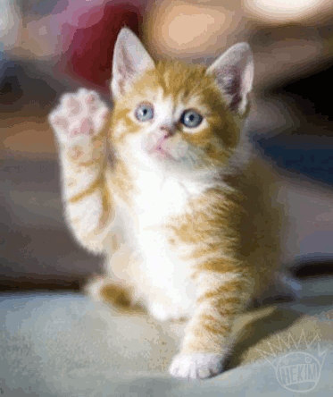

  
  <h1>Привет, я Пётр 👋</h1>

- 💻 Работаю разработчиком в **[Т-Банке](https://www.tbank.ru/)**.
- 🎓 Заканчиваю **[программную инженерию в НИУ ВШЭ](https://www.hse.ru/ba/se/)** — выпуск в **2027**.
- ❤️ Люблю **open source** и полезные проекты.
- 🚴 Вне работы — велосипед и домашние серверы.

За всё хорошее, против всего плохого 🙂

<h3 align="center">На связи</h3>

  
  
  

<h3 align="center">GitHub</h3>

  
  

  

